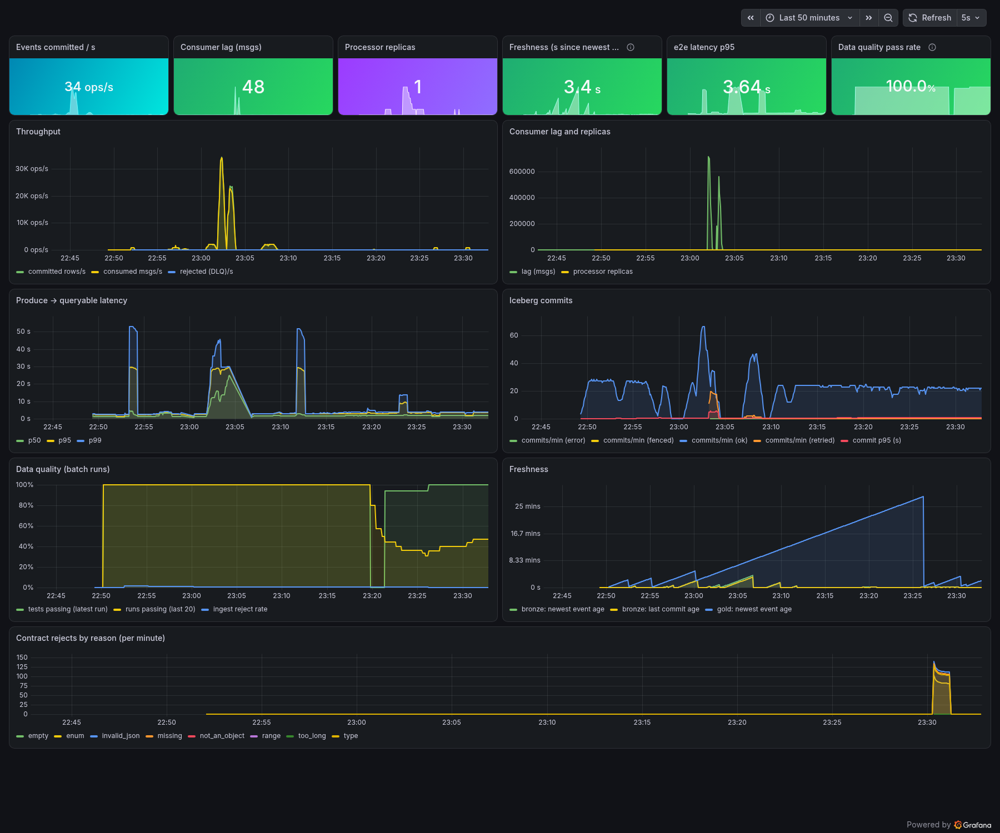
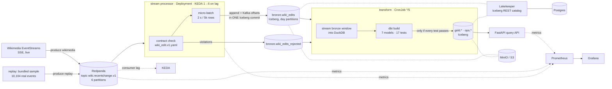
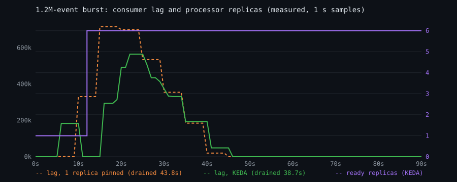

# floe

[](https://github.com/sushmit-gujar/floe/actions/workflows/ci.yml)


**A streaming lakehouse on Kubernetes that comes up with one command.** Live Wikipedia edits go through
Redpanda (Kafka API), are validated against a data contract, and land **exactly once** in Apache Iceberg tables on
S3-compatible storage. dbt then builds silver and gold models behind a data-quality gate, and a FastAPI service
serves the results. KEDA scales the stream processor on consumer lag, and Prometheus and Grafana track throughput, lag,
freshness and DQ pass rate. CI deploys the whole stack into a kind cluster and checks it end to end.

```
make up      # kind cluster + image + KEDA + the floe Helm chart
make e2e     # push 20k events (2% invalid, 1% late), assert exactly-once, DLQ, dbt tests, API, Prometheus, KEDA
make bench   # throughput, produce→queryable latency, autoscale reaction, pod-kill recovery
make grafana # http://localhost:3000 (user admin, password in Secret floe-credentials, key grafana-admin-password)
```



## Architecture



| Layer | What runs | Notes |
|---|---|---|
| Ingest | Redpanda v26.2.2, 6 partitions, 6 h retention | `produce wikimedia` forwards the live feed (with Last-Event-ID resume); `produce replay` sends the bundled sample at a fixed rate with unique ids per run |
| Stream | `floe process` (Python, confluent-kafka, pyiceberg 0.12) | contract validation, micro-batching, exactly-once commits, DLQ, Prometheus metrics |
| Lake | Apache Iceberg, Lakekeeper v0.14.1 REST catalog (Postgres 17), MinIO | STS-vended credentials; bronze is partitioned by `day(event_time)` |
| Batch | dbt-core 1.12 + dbt-duckdb, DuckDB 2.0 | silver dedupe, gold aggregates, ops quality; publishes to Iceberg only on a full pass |
| Serving | FastAPI | `/v1/summary`, `/v1/wikis`, `/v1/wikis/{wiki}/edits-per-minute`, `/v1/top-pages`, `/v1/quality` |
| Ops | KEDA 2.21, Prometheus v3.15, Grafana 13.2 | 13-panel dashboard provisioned from `deploy/grafana/build_dashboard.py` |
| Maintenance | `floe maintain` CronJob | compacts closed day partitions and expires old snapshots |

## How exactly-once works

The processor doesn't trust Kafka consumer-group offsets. **Its source of truth is the Iceberg table itself.**

1. Each batch is written as one Iceberg transaction: `append(rows)` plus `set_properties(floe.kafka.offsets=…)`.
   Either both become visible or neither does.
2. On partition assignment, the consumer seeks to the offsets stored in the table, not the group's committed offsets.
3. **Fencing:** before committing, the processor reloads the table and checks that the stored offset for each partition
   still equals where this batch started. If another replica got there first (a zombie after a rebalance or a slow
   SIGKILLed pod), the batch is dropped and the consumer re-seeks. Bronze sets `commit.retry.num-retries=0` so pyiceberg
   never silently rebases a stale commit onto a newer snapshot.
4. If the catalog is down, the processor pauses consumption, keeps its buffer and retries with backoff. A commit with
   an unknown outcome is resolved by the same fencing check.
5. Group offsets are committed after the Iceberg commit only so lag is visible to KEDA and Grafana.

The DLQ is at-least-once (rejects don't advance offsets on their own) and is deduped downstream.
`tests/test_exactly_once.py` covers restart, zombie fencing, rejects-only batches and stale commits against a
real Iceberg catalog (SQLite-backed in CI). The kind e2e test and the benchmarks check it again on the live stack by counting rows.

## Data quality gate

The contract (`src/floe/contracts/wiki_edit.v1.yaml`) defines 14 typed fields, enums, ranges, a 5% maximum reject
rate, a 900 s freshness SLA and a 600 s lateness threshold. Rows that fail it go to the DLQ with a reason. The
batch layer runs `dbt build` (7 models, 17 tests: schema tests plus 6 singular tests for reject rate, freshness, exactly-once,
gold↔silver reconciliation, grain and future timestamps). Gold tables are published back to Iceberg **only if every
test passes**. Every run, pass or fail, is appended to `ops.dq_runs`, which feeds the DQ panels.

**The gate caught a real problem during development.** After several `kubectl rollout restart`s of the live producer,
`assert_bronze_exactly_once` failed on five consecutive transform runs (23:21–23:25 EDT on 2026-10-24) and gold
wasn't published; `ops.dq_runs` records every one of them (exported in `results/dq-runs.json`). The duplicates were
Wikimedia events written at *different* Kafka offsets, i.e. the same event produced twice, not a processor replay.
The cause was a RollingUpdate briefly running two producers on the same SSE feed. Fixes:
the live producer now uses `strategy: Recreate`, and `ingest_quality` now separates **`bronze_duplicates`**
(one row per Kafka record: the processor guarantee, which the gate enforces) from **`source_duplicates`** (the same event
delivered twice upstream, deduped in silver and reported). After the fix, `ingest_quality` in the e2e run
(`results/e2e.json`) reported `bronze_duplicates = 0` over 2,866,099 bronze rows and `source_duplicates = 4,724`.

## Results (measured)

**Hardware:** one cloud VM, Intel Xeon, 8 vCPUs, 15.6 GiB RAM, kernel 6.12. kind v0.33.0 runs Kubernetes v1.37.0 on a
**single node**, so Redpanda, MinIO, Postgres, the catalog, Prometheus, Grafana and every processor replica share
the same 8 vCPUs. The steady, burst and pod-kill rows come from `make bench` (`results/bench.json`), run 2026-10-24
between 23:00 and 23:09 EDT; the e2e and batch rows come from `make e2e` (`results/e2e.json`) at 23:30 EDT.
Latency is *produce → queryable*: the Iceberg snapshot timestamp of the commit that made the row visible, minus the
producer's send time.

| Scenario | Result |
|---|---|
| Steady, 2,000 ev/s for 60 s, 1 replica | 120,000 rows, **0 duplicates, 0 missing**; latency **p50 1,356 ms · p95 2,394 ms · p99 2,491 ms** · max 2,573 ms (2 s flush interval) |
| Burst, 1.2M events, 1 replica pinned | produced at 111k ev/s; drained in **43.8 s = 27,385 ev/s** end to end; exactly once |
| Burst, 1.2M events, KEDA (1→6) | first scale-out decision **7.0 s** after burst start, **6 replicas ready at 12.0 s**; drained in **38.7 s = 30,968 ev/s**; back to 1 replica at 218 s; exactly once |
| Pod kill (SIGKILL, grace 0), 2 replicas at 2,000 ev/s | replacement Ready in **5.4 s**; largest gap between Iceberg commits **2.46 s**; survivor's first commit 0.09 s after the kill; 180,000 rows **0 duplicates, 0 missing**; p99 2,782 ms |
| e2e (`make e2e`), 20,000 events incl. 390 invalid and 177 late | 19,610 rows exactly once, 390/390 in the DLQ, p50 1,347 ms / p95 1,426 ms; dbt 17/17 tests passed, gold published |
| Batch layer at scale | `dbt build` over a 24 h window (**2.88M silver rows**) in 13.6 s inside a 1,536 MiB pod limit |



**Reading the autoscaling numbers honestly:** KEDA's gain here is only about 13% (30,968 vs 27,385 ev/s). The burst is short compared with
the time it takes to scale out, and on a single 8-vCPU node the extra replicas compete with Redpanda and MinIO for CPU.
On a multi-node cluster the per-replica throughput (about 27k ev/s) has room to add up. That isn't measured here.
The lag curve is step-shaped because lag is read from the group offsets committed after each Iceberg commit.

The batch row needed real work: the first version loaded the window through dbt-duckdb's in-memory pyiceberg source plugin
and was **OOM-killed** at 2.8M rows. Bronze is now streamed in record batches into DuckDB under a `memory_limit`
(it spills to local disk), and the silver dedupe is a hash aggregate plus join instead of a full-width window function.

## Kubernetes and security

- **Helm chart** (`deploy/helm/floe`): requests and limits on everything, liveness/readiness probes, a PDB for the processor,
  init containers that wait for dependencies, and a bootstrap Job per revision (bucket, catalog warehouse, tables, topic).
- **KEDA** `ScaledObject` on Kafka lag (threshold 5,000 per replica, max 6 = partition count, scale-up stabilisation 0,
  scale-down 60 s). Falls back to a CPU HPA with `processor.autoscaling.keda=false`.
- **Secrets** (MinIO, Postgres, Grafana) are generated by Helm on first install (`randAlphaNum`, kept with `lookup`).
  Nothing sensitive is committed or put in values.
- **Pod security:** every container runs as non-root, with `readOnlyRootFilesystem`, seccomp `RuntimeDefault`, all capabilities dropped and no
  privilege escalation. Workload service accounts don't mount tokens. Prometheus gets a namespaced Role for pod discovery only.
- **NetworkPolicies:** default-deny ingress, then label-based allows (`floe.io/kafka-client`, `catalog-client`,
  `s3-client`, `postgres-client`) and the KEDA namespace. The CI e2e test runs with `--require-netpol`, which proves that a pod
  without the label *cannot* reach Postgres.
- **Image:** multi-stage build on `python:3.12-slim-trixie` with uv, locked dependencies (`requirements.lock`), no pip
  at runtime, uid 10001.
- **Trivy in CI:** the build fails on any *fixable* HIGH/CRITICAL CVE, a full SARIF report goes to code scanning, and a misconfiguration scan
  of the Helm chart fails on HIGH/CRITICAL. A local Trivy 0.76.1 scan on 2026-10-24 (`results/trivy-image.json`) found 0 critical and
  44 high findings, all in Debian base packages with no fix available. The Python dependencies were clean.

## CI

`.github/workflows/ci.yml` runs on every push:

1. **test:** ruff plus 22 pytest tests on Python 3.11, 3.12 and 3.13. They cover the contract, exactly-once (restart, zombie fencing,
   stale commits), the dbt gate (pass, duplicates block publishing, source duplicates are deduped, reject-rate breach), partition compaction and the API (including picking up the first gold publish without waiting out its cache TTL),
   all against a real Iceberg catalog with no broker.
2. **chart:** `helm lint` and `kubeconform -strict` for both the KEDA and HPA variants.
3. **image:** build, non-root check, Trivy gates and SARIF upload.
4. **e2e:** creates a kind cluster, installs KEDA, `make deploy`, runs the full `run_e2e.py --require-netpol` (the same 20,000
   events and checks as `make e2e`, plus NetworkPolicy enforcement), then a smaller benchmark smoke run than `make bench`:
   steady 1,000 ev/s for 30 s and a pod kill at 1,000 ev/s for 60 s (no 1.2M bursts), which fails the job unless both stay
   exactly once. Results are uploaded as an artifact.

The first green run (`results/e2e-ci.json`, `results/bench-ci.json`, run
[40160447133](https://github.com/sushmit-gujar/floe/actions/runs/40160447133), 2026-10-25 00:03 EDT, on a 4-vCPU AMD EPYC 7763
GitHub runner with kind v0.31.0 / Kubernetes v1.35.0) passed all 9 e2e checks with NetworkPolicies enforced: 19,610 rows,
0 duplicates, 0 missing, p50 2,063 ms / p95 2,199 ms. The smoke run delivered 30,000 steady rows (p95 2,260 ms) and 60,000 rows
through a SIGKILL (replacement Ready in 7.1 s, largest commit gap 6.98 s), all exactly once.

Enforcing NetworkPolicies in CI caught a real gap the dev VM couldn't: the live producer's init container read the Iceberg
catalog, but the producer pod only carries `floe.io/kafka-client`, so it hung in `Init` until Helm timed out. Kafka-only
clients now wait for the topic only (`wait-ready --no-catalog`).

## Running it

Requirements: Docker, kind, kubectl, Helm and about 6 GiB of free RAM. No cloud account or API keys.

```bash
make up                         # cluster + build + KEDA + chart
make status                     # pods, ScaledObject, CronJobs
make api                        # port-forward the API to :8000, then e.g. curl :8000/v1/summary
make bench                      # full benchmark (about 10 min), writes results/bench.json and timelines
python3 bench/plot_timeline.py  # re-render docs/autoscale.svg
make down
```

Local development without Kubernetes: `pip install -e ".[dev]" && pytest` (uses a SQLite Iceberg catalog and local files).

## Limitations

- **Single node.** All benchmarks share one 8-vCPU node, so the absolute numbers are a floor, not a capacity plan.
- **NetworkPolicies were not enforced on the dev VM**, because its kernel lacks `NETFILTER_NETLINK_QUEUE`, which kindnet's policy
  agent needs. The local e2e reports this. Enforcement is asserted in CI on GitHub's runners.
- The processor image is 1.09 GB (pyarrow, DuckDB and dbt in one image so a single artifact serves every role).
- MinIO stopped publishing community images in October 2025, so the chart uses `cgr.dev/chainguard/minio:latest`
  (a floating tag). Pin a digest for anything long-lived.
- The DLQ is at-least-once by design. Bronze is exactly once per Kafka record. Upstream repeats are deduped in silver.

## Data

The live mode reads [Wikimedia EventStreams](https://stream.wikimedia.org/?doc) (`recentchange`). The bundled replay
sample (`src/floe/data/wikimedia-recentchange-sample.jsonl.gz`, 10,104 events) was captured from that public feed, with
user names replaced by short one-way hashes and only the fields the contract needs kept. Event data comes from the
Wikimedia Foundation's public stream (see its terms of use). The code is MIT licensed.
